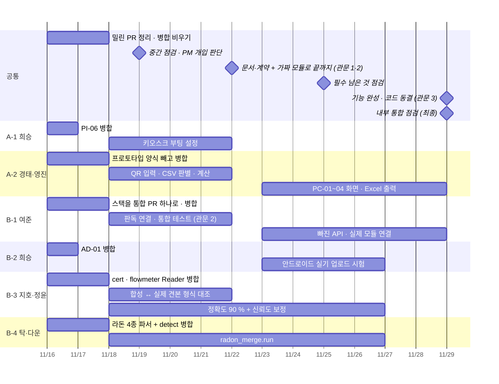

# 06 일정 · 관문

- 버전 1.2 (2026-11-16) · 목표: **11/22(일) 관문 1·2, 11/29(일) 기능 완성·코드 동결 + 내부 통합 점검**
- 바뀐 점 (1.2): 11/15 마감까지 밀린 PR이 병합되지 않아 날짜를 다시 잡았다. 범위도 줄였다 — **시작하지 못한 권장(S)과 가스 쪽은 2차(C)로 내렸다.**
- 이전 버전: 1.1 (2026-11-08, KTL 시연 취소 · 11/11 · 11/15) · 1.0 (10/25 · 11/1 · 11/6 · 11/8)
- 관문 = GitHub Milestone. 이슈의 마감일은 Milestone 날짜다.
- 일정 안에 안 된 부분은 PM이 개입해 완성시킨다. 그래서 **늦어질 것 같으면 빨리 말하는 것**이 가장 중요하다.

## 11/16 기준 진행 상황 (다시 짠 이유)

- main에 마지막으로 병합된 것은 **11/1**이다. 열린 PR이 27개이고, 필수(M) 이슈는 51개 중 18개(35 %)가 끝났다.
- 막힌 이유는 코드가 아니라 **리뷰 · 병합**이다. 리뷰를 못 받은 PR, 승인됐지만 병합을 기다리는 PR, CI가 실패한 채 멈춘 PR이 섞여 있다.
- 그래서 순서는 1.1과 같다: **① 밀린 PR부터 비우고 → ② 관문 2를 끝내고 → ③ 필수(M)만 끝까지.**

## 이번에 범위에서 뺀 것 (2차 · C)

| 파트 | 2차로 내린 이슈 | 이유 |
|---|---|---|
| A-1 (flow-pi) | PI-03 서류 촬영·OCR 대조 (#8), PI-04 기준정보 확인 (#9), USB 백업·복원 (#10) | 시작하지 못한 S |
| A-2 (flow-pc) | QR ↔ CSV 교차 확인 (#8), exe 하나로 실행 (#10) | 시작하지 못한 S |
| B-2 (field-web) | AD-02 가스 그래프 (#9), AD-03 라돈 병합 화면 (#10) | 시작하지 못한 S |
| B-3 (modules) | 측정 전 화면 감지 경고 (#7) | 시작하지 못한 S |
| B-4 (modules) | 가스: GL240 생성기 (#8) · 파서 (#10) · RT90 (#14) · 안정 구간 추천 (#16) | 보류가 풀리지 않음 |

- 이미 PR이 올라온 S는 그대로 둔다: 서버 해시 체인 · 회전 보정 · 워터마크 zip, dust Reader, 라돈 시각 정렬, 민감도 그래프.
- 가스가 빠지므로 **시나리오 C(가스 선별)는 내부 통합 점검 대상이 아니다.** 시나리오 D(라돈)는 화면(AD-03) 없이 서버 API로 확인한다.

## 파트별 할 일

| 파트 | 관문 2까지 (11/22) | 관문 3까지 (11/29) | 권장 (S) — 필수가 끝나면 |
|---|---|---|---|
| A-1 희승 (flow-pi) | PI-06 기기 등록·수정 (#6, PR #18) 병합 | 키오스크 부팅 (#7) | — |
| A-2 경태·영진 (flow-pc) | 프로토타입 PR #19에서 Excel 양식을 빼고 병합 → 형태·뼈대 (#1), 합성 CSV (#2), QR (#3), CSV 판별 (#4), 계산 (#5) 완료 기준 확인 / PR #20은 main에서 새 브랜치로 다시 | PC-01~04 화면 (#6), 통일 Excel + 출처 시트 (#7) | 민감도 그래프 (#9) |
| B-1 여준 (field-server) | 쌓아 둔 PR을 통합 PR 하나로 올려 병합 (#2 · #4 · #5 · #6 · #7 · #8 · #9 · #10) / 판독 연결 (#36), 통합 테스트 (#16) | 빠진 사진·건 API (#37), 실제 모듈 연결 (#11) | 해시 체인 (#12), 회전 보정 (#13), 워터마크 zip (#14) — 통합 PR에 포함 |
| B-2 희승 (field-web) | AD-01 (#8, PR #21) 병합 | 안드로이드 실기 시험 (#11) | — |
| B-3 지호·정윤 (modules) | cert (#3, PR #27) · flowmeter (#4, PR #26 — 승인 필요) 병합 / 견본 형식 대조 (#18) | 정확도 90 % + 신뢰도 보정 (#5, PR #30 — 이슈 번호 · cert.py 겹침 · CI 설치 줄 고치기) | dust Reader (#6, PR #31 — CI에 `readers[screen]` 설치) |
| B-4 탁·다운 (modules) | 라돈 4종 파서 (#11, PR #22 — Draft 풀기) | radon_merge.run (#13, PR #29) | 라돈 시각 정렬 (#15, PR #28 — 충돌 풀기) |

- 번호는 각 파트 레포의 이슈 · PR 번호다.
- 라돈 PR은 #22 → #29 → #28 순서로 병합한다.

## 관문별 확인 항목

### 11/16(월) ~ 11/18(수) — 밀린 PR 정리 · 병합 비우기

- [ ] PM이 PR마다 남긴 요청 댓글(11/16)을 작성자가 처리한다 — 이슈 번호, CI 실패, 충돌, Draft 해제
- [ ] 리뷰 요청받은 PR은 **그날 안에** 리뷰한다 (승인 · 수정 요청 · 질문 중 하나라도)
- [ ] 승인된 PR은 PM이 병합한다
- [ ] 이번 주 안에 손대기 어려우면 **댓글로 바로 알린다** — 파트너나 PM이 이어받는다

### 11/19(목) 중간 점검 — PM 개입 판단

- 11/16 요청에 **답이 없는 PR**은 PM이 파트너에게 넘기거나 직접 정리한다
- 파트별 M(필수) 이슈 진행률 확인, 필요하면 범위를 더 줄인다
- 결정 내용은 ktl-hub 이슈로 공지

### 관문 1·2 — 11/22(일) 문서·계약 + 가짜 모듈로 끝까지

- [ ] 관문 1에 남은 것 마무리: 공동 문서 확인 체크 (ktl-hub #1), A-2 형태 결정 · 합성 CSV
- [ ] B: 휴대폰 촬영 → 서버 업로드 → 가짜 Reader 값 → MO-06 확정 → AD-04 CSV 내보내기 (실제 휴대폰으로)
- [ ] A: Pi QR 표시 → 실험 PC 스캔 → 기기 정보 채움
- [ ] A-2: 합성 CSV 6개 판별·계산
- [ ] B-3·B-4: 첫 실제 Reader/Selector가 계약 테스트 통과하고 **main에 병합**

### 11/25(수) 필수 남은 것 점검

- 남은 M(필수) 이슈를 파트별로 확인하고, 11/29까지 못 끝낼 것은 PM이 같이 들어간다
- 이때부터 새 S(권장)는 시작하지 않는다. 남은 날은 필수(M)와 버그만

### 관문 3 — 11/29(일) 기능 완성 · 코드 동결

- [ ] 모든 M 요구사항 완료 기준 만족 + PR 병합
- [ ] B: 실제 모듈(cert·flowmeter)로 시나리오 B 동작
- [ ] B: 라돈은 radon_merge 모듈 + 서버 병합 API까지 동작 (시나리오 D는 API로 확인)
- [ ] A: 시나리오 A 전체 동작, Excel이 양식대로
- [ ] 인터넷 끊고 전체 동작 확인
- 이후에는 버그 수정 PR만 받는다

### 최종 — 11/29(일) 내부 통합 점검

- KTL 시연은 없다. 팀 안에서 완성도를 확인하는 자리다.
- [ ] 시나리오 A · B · D를 맡지 않은 팀원이 순서대로 따라 해 본다 (ktl-hub #6). 시나리오 C(가스)는 이번 범위가 아니다
- [ ] 발견한 문제는 이슈로 남기고, 심각한 것만 수정

## 확인 요청 (PM이 연구원님께)

| 대상 | 무엇 | 필요한 파트 | 언제까지 받으면 좋은가 |
|---|---|---|---|
| 과제 A 연구원님 | 직선성 정의, 성적서 값 선택, 원본 성적서 양식, 그래프 필요 여부 | A-2 | 11/19 |
| 과제 A 연구원님 | LCD QR 방식 동의 (ktl-hub #13), 차압계·S/W 기준정보 | A-1 · A-2 | 11/19 |
| 과제 B 연구원님 | 시료채취 6칸·먼지 12칸 매핑 | B-3 | 11/19 |
| 과제 B 연구원님 | 라돈 정렬 기준, 출력 파일명·인코딩, 사진 보관 기간 | B-1 · B-4 | 11/22 |
| KTL 정보보안 | 장비 반입, 결과 파일 반출 방법, 견본·양식 취급 | 전체 | 11/25 |

답이 오기 전에는 01 요구사항 §9의 "임시로 이렇게"대로 진행한다.
