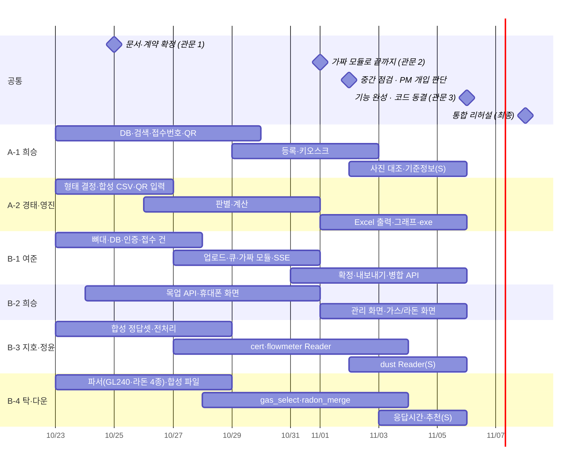

# 06 일정 · 관문

- 버전 1.0 (2026-10-22) · 목표: **11/6(금) 기능 완성·코드 동결, 11/8(일) 통합 리허설**
- 관문 = GitHub Milestone. 이슈의 마감일은 Milestone 날짜다.
- 일정 안에 안 된 부분은 PM이 개입해 완성시킨다. 그래서 **늦어질 것 같으면 빨리 말하는 것**이 가장 중요하다.

## 관문별 확인 항목

### 관문 1 — 10/25(일) 문서·계약 확정

- [ ] 전원: 01~06 문서를 읽고 ktl-hub "문서 확인" 이슈에 체크 (질문은 이슈로)
- [ ] 전원: 내 레포 클론, 실행 뼈대 PR 1개 병합 (README 실행 방법 포함)
- [ ] A-2: 형태(파이썬/HTML) 결정을 이슈에 기록
- [ ] B-1·B-2: OpenAPI 고정, 목업 서버로 휴대폰 첫 화면 표시
- [ ] B-3·B-4: `ktl_contract` 계약 테스트가 가짜 모듈로 통과, 합성 파일 첫 묶음
- [ ] A-1·A-2: QR 테스트 벡터를 각자 코드로 통과

### 관문 2 — 11/1(일) 가짜 모듈로 끝까지

- [ ] B: 휴대폰 촬영 → 서버 업로드 → 가짜 Reader 값 → MO-06 확정 → AD-04 CSV 내보내기 (실제 휴대폰으로)
- [ ] A: Pi QR 표시 → 실험 PC 스캔 → 기기 정보 채움
- [ ] A-2: 합성 CSV 6개 판별·계산 화면
- [ ] B-3·B-4: 첫 실제 Reader/Selector가 계약 테스트 통과

### 11/2(월) 중간 점검 — PM 개입 판단

- PM 보고서 기준으로 파트별 M(필수) 이슈 진행률 확인
- **M 이슈 진행률 60 % 미만** 또는 **막힘 2일 이상** 파트 → PM이 같이 들어가거나 범위를 S → C로 내림
- 결정 내용은 ktl-hub 이슈로 공지

### 관문 3 — 11/6(금) 기능 완성 · 코드 동결

- [ ] 모든 M 요구사항 완료 기준 만족 + PR 병합
- [ ] B: 실제 모듈(cert·flowmeter·gas·radon)로 시나리오 B·C·D 동작
- [ ] A: 시나리오 A 전체 동작, Excel이 형식대로
- [ ] 인터넷 끊고 전체 시연
- 이후에는 버그 수정 PR만 받는다

### 최종 — 11/8(일) 통합 리허설

- [ ] 시나리오 A~D를 처음 보는 사람이 대본대로 따라 해 본다
- [ ] 발견한 문제는 이슈로, 심각한 것만 수정
- [ ] 시연 순서·역할 확정

## 확인 요청 (PM이 연구원님께)

| 대상 | 무엇 | 필요한 파트 | 언제까지 받으면 좋은가 |
|---|---|---|---|
| 과제 A 연구원님 | 직선성 정의, 성적서 값 선택, 원본 성적서 양식, 그래프 필요 여부 | A-2 | 10/28 |
| 과제 A 연구원님 | LCD QR 방식 동의, 차압계·S/W 기준정보 | A-1 | 10/28 |
| 과제 B 연구원님 | 시료채취 6칸·먼지 12칸 매핑, 가스 선별 정답 예시 | B-3 · B-4 | 10/28 |
| 과제 B 연구원님 | 라돈 정렬 기준, 출력 파일명·인코딩, 사진 보관 기간 | B-1 · B-4 | 11/1 |
| KTL 정보보안 | 장비 반입, 결과 파일 반출 방법 | 전체 | 11/4 |

답이 오기 전에는 01 요구사항 §9의 "임시로 이렇게"대로 진행한다.
