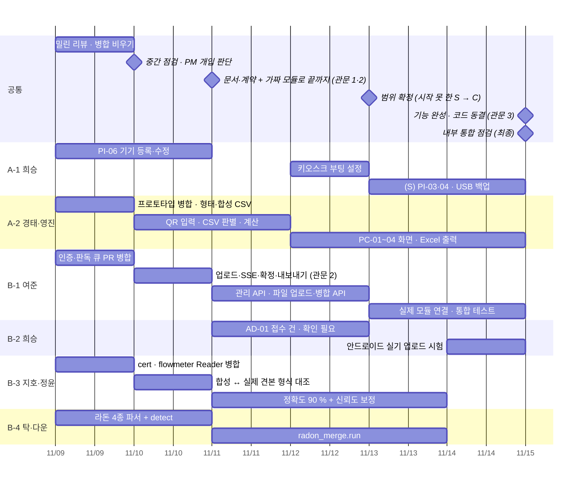

# 06 일정 · 관문

- 버전 1.1 (2026-11-08) · 목표: **11/11(수) 관문 1·2, 11/15(일) 기능 완성·코드 동결 + 내부 통합 점검**
- 바뀐 점: KTL 시연(11/8 통합 리허설)이 없어졌다. 대신 전체 마감을 **11/15(일)**로 미루고, 11/8까지의 진행 상황에 맞춰 다시 짰다 (버전 1.0: 10/25 · 11/1 · 11/6 · 11/8).
- 관문 = GitHub Milestone. 이슈의 마감일은 Milestone 날짜다.
- 일정 안에 안 된 부분은 PM이 개입해 완성시킨다. 그래서 **늦어질 것 같으면 빨리 말하는 것**이 가장 중요하다.

## 11/8 기준 진행 상황 (다시 짠 이유)

- main에 마지막으로 병합된 것은 11/1이다. 그 뒤 PR이 **리뷰를 기다리며 쌓여 있다** (리뷰 0건인 PR이 여럿, 가장 오래된 것은 10/24 초안).
- 관문 2(가짜 모듈로 끝까지)가 아직 열려 있고, 관문 3의 필수(M) 이슈는 대부분 시작 전이거나 진행 중이다.
- 그래서 이번 주는 **① 밀린 리뷰 · 병합부터 비우고 → ② 관문 2를 끝내고 → ③ 필수(M)만 끝까지** 순서로 간다. 권장(S)은 필수가 끝난 파트만 한다.

## 파트별 할 일

| 파트 | 관문 2까지 (11/11) | 관문 3까지 (11/15) | 권장 (S) — 필수가 끝나면 |
|---|---|---|---|
| A-1 희승 (flow-pi) | — | PI-06 기기 등록·수정 (#6), 키오스크 부팅 (#7) | PI-03 (#8), PI-04 (#9), USB 백업 (#10) |
| A-2 경태·영진 (flow-pc) | 승인된 프로토타입 PR #19 병합 → 그 위에서 형태·뼈대 (#1), 합성 CSV (#2), QR (#3), CSV 판별 (#4), 계산 (#5) 완료 기준 확인 | PC-01~04 화면 (#6), 통일 Excel + 출처 시트 (#7) | 민감도 그래프 (#9), QR↔CSV 교차 확인 (#8), exe (#10) |
| B-1 여준 (field-server) | 인증 (#2, PR #23) · 판독 큐 (#5, PR #24) 병합 / 업로드 (#4), SSE (#6, PR #27), 확정 (#7, PR #26), 내보내기 (#8, PR #28), 통합 테스트 (#16) | 관리 API (#10, PR #29), 파일 업로드·병합 API (#9, PR #30), 실제 모듈 연결 (#11) | 해시 체인 (#12), 회전 보정 (#13), 워터마크 zip (#14) |
| B-2 희승 (field-web) | — | AD-01 (#8), 안드로이드 실기 시험 (#11) | AD-02 (#9), AD-03 (#10) |
| B-3 지호·정윤 (modules) | cert (#3, PR #27 승인됨) · flowmeter (#4, PR #26) 병합 / 견본 형식 대조 (#18) | 정확도 90 % + 신뢰도 보정 (#5, PR #30 — CI 실패 고치기) | dust Reader (#6, PR #31 — CI에 OpenCV 추가), 측정 전 화면 경고 (#7) |
| B-4 탁·다운 (modules) | 라돈 4종 파서 (#11, PR #22 초안) | radon_merge.run (#13, PR #29 초안) | 라돈 시각 정렬 (#15, PR #28 — 충돌 풀고 병합) |

- 가스 쪽(GL240 생성기 #8 · 파서 #10 · RT90 #14 · 안정 구간 추천 #16)은 `status:보류`다. 보류가 풀리면 위 순서에 끼워 넣는다 (11/10 중간 점검에서 PM이 결정).
- 번호는 각 파트 레포의 이슈 · PR 번호다.

## 관문별 확인 항목

### 11/9(월) ~ 11/10(화) — 밀린 리뷰 · 병합 비우기

- [ ] 리뷰 요청받은 PR은 **그날 안에** 리뷰한다 (승인 · 수정 요청 · 질문 중 하나라도)
- [ ] 승인된 PR은 PM이 병합한다. 충돌 난 PR은 작성자가 main을 받아 풀고 다시 올린다
- [ ] CI가 실패한 PR은 작성자가 먼저 고친다 (PR 본문 `Closes #번호`, 테스트 환경 패키지 포함)
- [ ] 초안 PR 중 다 된 것은 "리뷰 준비 완료"로 바꾼다

### 11/10(화) 중간 점검 — PM 개입 판단

- 파트별 M(필수) 이슈 진행률 확인
- **리뷰 없이 1일 넘은 PR** 또는 **막힘 1일 이상** 파트 → PM이 같이 들어가거나 범위를 줄인다
- 보류 중인 가스 이슈를 할지 결정
- 결정 내용은 ktl-hub 이슈로 공지

### 관문 1·2 — 11/11(수) 문서·계약 + 가짜 모듈로 끝까지

- [ ] 관문 1에 남은 것 마무리: 공동 문서 확인 체크 (ktl-hub #1), A-2 형태 결정 · 합성 CSV
- [ ] B: 휴대폰 촬영 → 서버 업로드 → 가짜 Reader 값 → MO-06 확정 → AD-04 CSV 내보내기 (실제 휴대폰으로)
- [ ] A: Pi QR 표시 → 실험 PC 스캔 → 기기 정보 채움
- [ ] A-2: 합성 CSV 6개 판별·계산
- [ ] B-3·B-4: 첫 실제 Reader/Selector가 계약 테스트 통과하고 **main에 병합**

### 11/13(금) 범위 확정

- 이때까지 **시작하지 못한 S(권장)는 C(2차)로 내린다**. 남은 이틀은 필수(M)와 버그만.

### 관문 3 — 11/15(일) 기능 완성 · 코드 동결

- [ ] 모든 M 요구사항 완료 기준 만족 + PR 병합
- [ ] B: 실제 모듈(cert·flowmeter)로 시나리오 B 동작
- [ ] B: 라돈은 radon_merge 모듈 + 서버 병합 API까지 동작 (시나리오 D 화면 AD-03은 S라 되면 화면으로, 아니면 API로 확인). 가스 시나리오 C는 보류가 풀린 경우만
- [ ] A: 시나리오 A 전체 동작, Excel이 형식대로
- [ ] 인터넷 끊고 전체 동작 확인
- 이후에는 버그 수정 PR만 받는다

### 최종 — 11/15(일) 내부 통합 점검

- KTL 시연은 없다. 팀 안에서 완성도를 확인하는 자리다.
- [ ] 시나리오 A~D를 맡지 않은 팀원이 순서대로 따라 해 본다 (ktl-hub #6)
- [ ] 발견한 문제는 이슈로 남기고, 심각한 것만 수정

## 확인 요청 (PM이 연구원님께)

| 대상 | 무엇 | 필요한 파트 | 언제까지 받으면 좋은가 |
|---|---|---|---|
| 과제 A 연구원님 | 직선성 정의, 성적서 값 선택, 원본 성적서 양식, 그래프 필요 여부 | A-2 | 11/10 |
| 과제 A 연구원님 | LCD QR 방식 동의, 차압계·S/W 기준정보 | A-1 | 11/10 |
| 과제 B 연구원님 | 시료채취 6칸·먼지 12칸 매핑, 가스 선별 정답 예시 | B-3 · B-4 | 11/10 |
| 과제 B 연구원님 | 라돈 정렬 기준, 출력 파일명·인코딩, 사진 보관 기간 | B-1 · B-4 | 11/11 |
| KTL 정보보안 | 장비 반입, 결과 파일 반출 방법 | 전체 | 11/13 |

답이 오기 전에는 01 요구사항 §9의 "임시로 이렇게"대로 진행한다.
